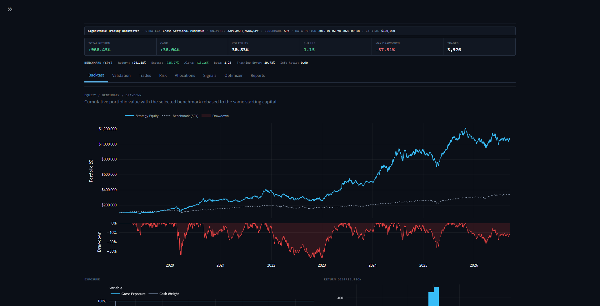
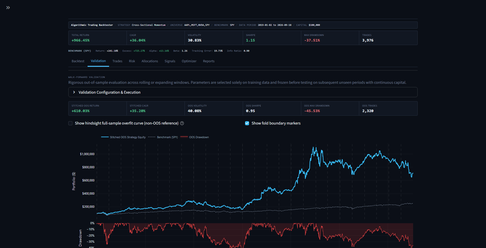
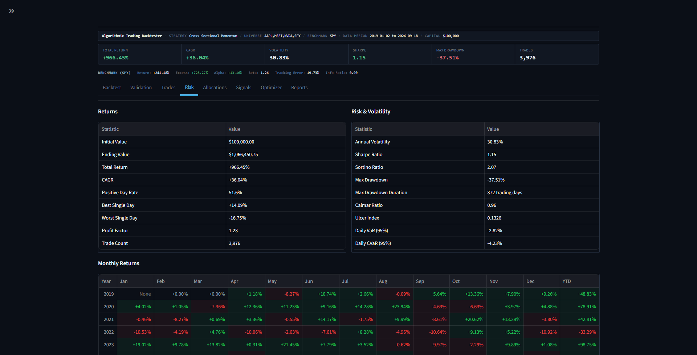
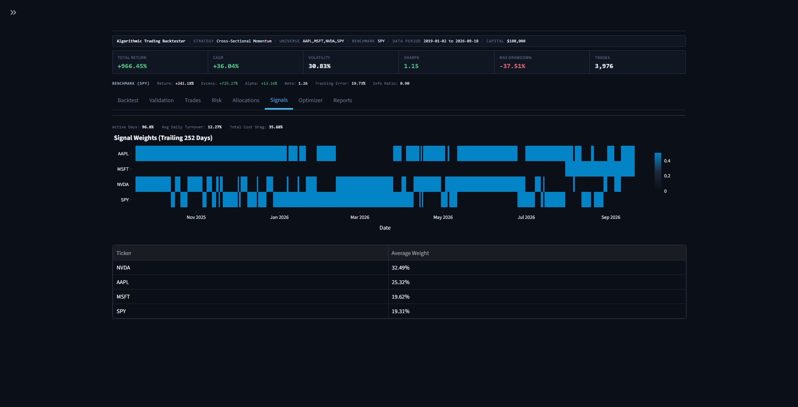
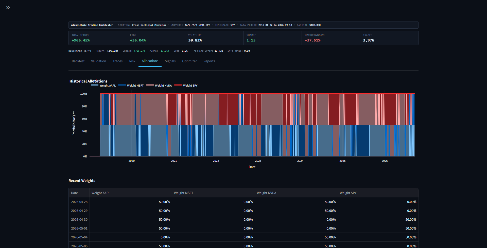
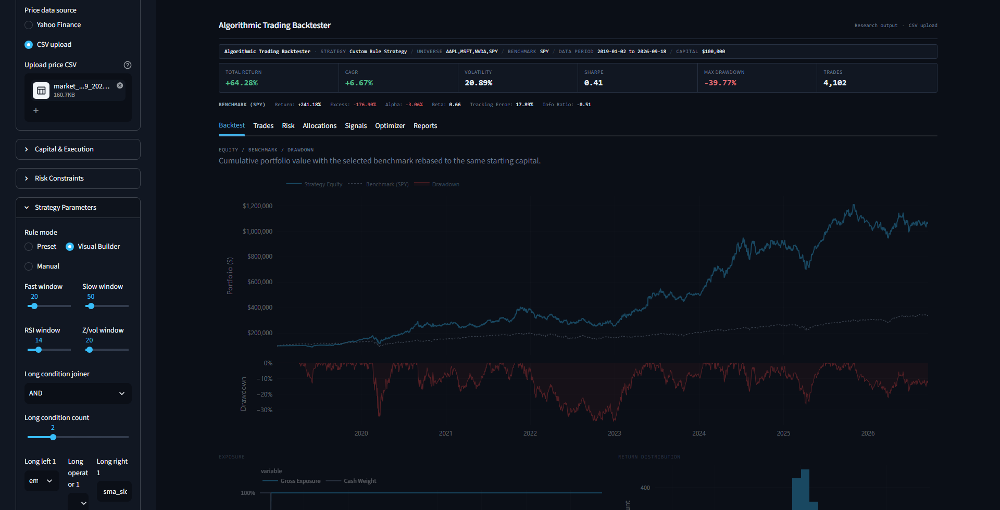

# Algorithmic Trading Backtester

Python backtesting project for multi-asset strategies that emit target portfolio weights. It loads adjusted-close data from Yahoo Finance or CSV, simulates rebalancing with commissions and slippage, compares the result with a benchmark, and reports performance, risk, and trade statistics. The Streamlit app also provides parameter search and walk-forward validation.

## Core strategies

- Moving Average Crossover
- RSI Mean Reversion
- MACD Trend Following
- Bollinger Mean Reversion
- Donchian Channel Breakout
- Buy and Hold

## Features

- Load adjusted-close prices from Yahoo Finance or wide/long CSV files.
- Run built-in trend, mean-reversion, momentum, allocation, pairs, ensemble, and custom-rule strategies.
- Simulate long-only or long/short target weights with daily, weekly, or monthly rebalancing.
- Apply per-asset weight limits, gross-exposure limits, and optional volatility targeting.
- Record share changes, execution prices, notionals, turnover, commissions, and slippage.
- Calculate returns, CAGR, volatility, Sharpe and Sortino ratios, drawdown, VaR/CVaR, and benchmark comparison metrics.
- Run grid searches and rolling or expanding walk-forward validation. Parameters are selected on training windows and then held fixed for the following test windows.
- Define custom rules with presets, a visual condition builder, or validated pandas expressions.

## Strategies

The built-in strategies include:

- Moving Average Crossover, MACD Trend Following, and Donchian Channel Breakout

See [STRATEGY_GUIDE.md](STRATEGY_GUIDE.md) for the strategy list and extension example. See [CUSTOM_RULE_BUILDER.md](CUSTOM_RULE_BUILDER.md) for the expression syntax and supported indicators.

## Screenshots

### Backtest


### Walk-forward validation


### Risk


### Signals


### Allocations


### Custom strategy


## How it works

1. The data loader normalizes dates and symbols, filters the requested period, and returns a common price frame.
2. A strategy generates target weights for each available date.
3. The portfolio simulator applies exposure controls and the rebalance schedule, converts target values to shares, and deducts trading costs.
4. The engine builds the equity and benchmark curves and calculates metrics from the resulting history.
5. Walk-forward validation selects parameters on each training window, uses earlier rows only for indicator warm-up, applies the frozen parameters to the next test window, and stitches the test windows with continuous capital.

## Running locally

```bash
python -m venv .venv

# Windows PowerShell
.venv\Scripts\Activate.ps1

# macOS/Linux
# source .venv/bin/activate

python -m pip install -r requirements.txt
streamlit run app.py
```

The app can load Yahoo Finance data or a CSV file. Yahoo Finance access requires a network connection; CSV input is available for repeatable local runs with a fixed dataset.

The command-line example uses Yahoo Finance data and writes report files to `reports/`:

```bash
python run_backtest.py
```

## Testing

```bash
pytest
```

## Project layout

```text
app.py                     Streamlit application
run_backtest.py            Command-line example
src/data/                  Price loading and normalization
src/backtester/            Engine, portfolio, metrics, optimization, reports
src/strategies/            Built-in and custom strategies
tests/                     Pytest suite
docs/                      Documentation screenshots
```

## Limitations

- Yahoo Finance data availability and the latest date depend on the data provider. The effective period is the range of rows actually loaded and used by the run.
- The simulator uses daily prices and simple commission/slippage assumptions. It does not model intraday execution, market impact, taxes, borrow availability, or order-book behavior.
- A selected ticker universe is not a survivorship-bias-free index study; delisted assets are not added automatically.
- Walk-forward validation separates parameter selection from later test windows, but it cannot establish future profitability.
