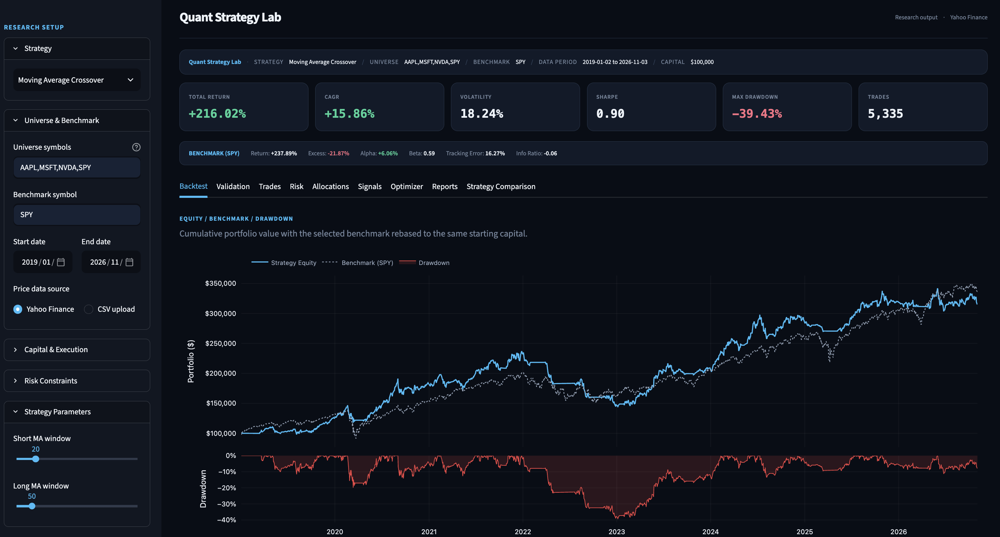
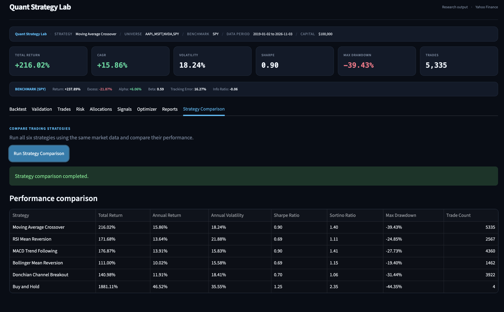
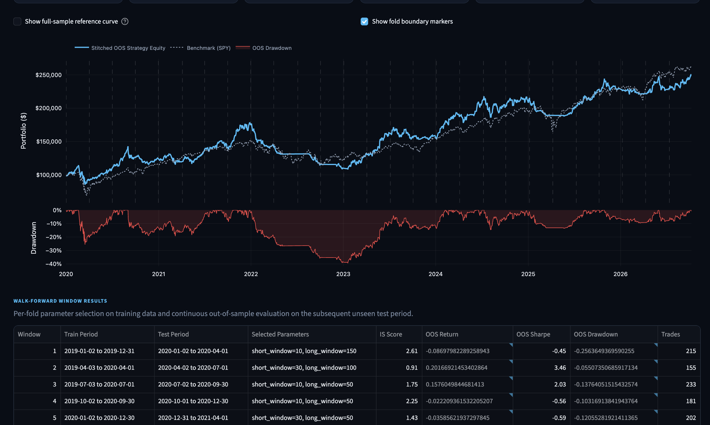
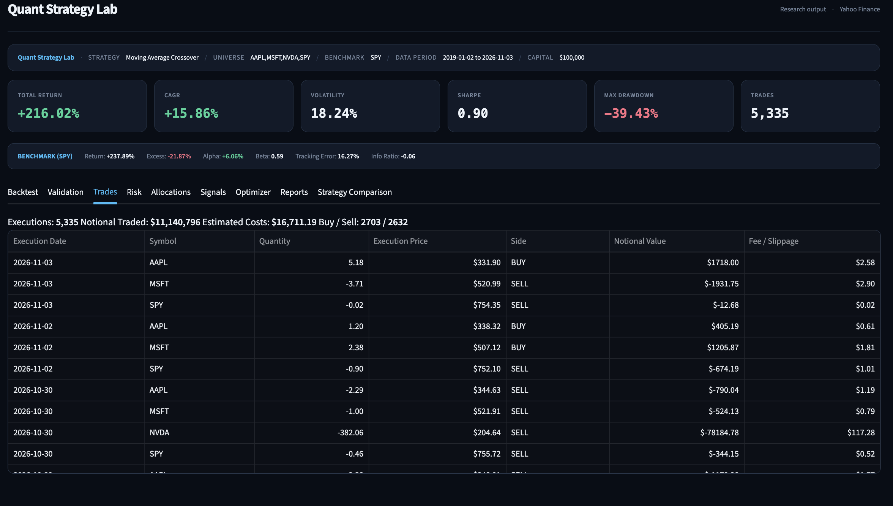
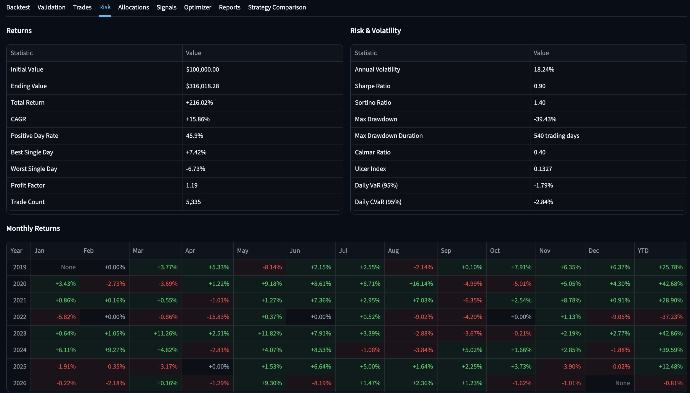
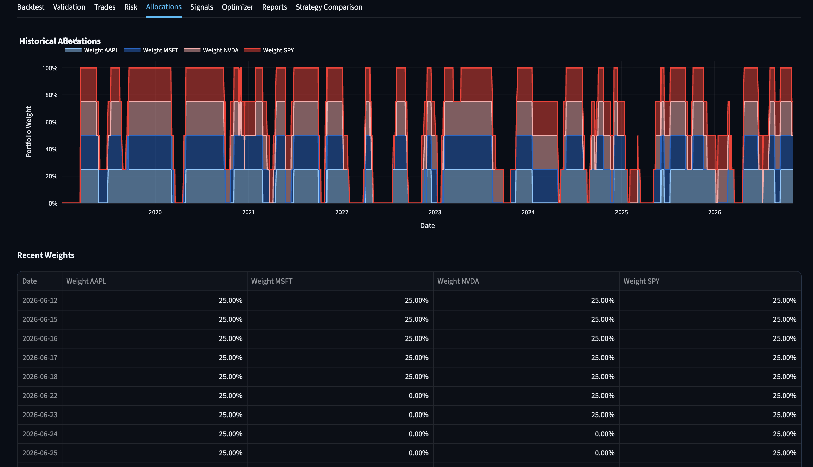
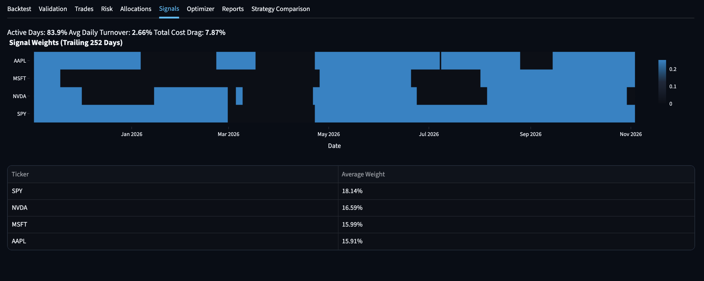
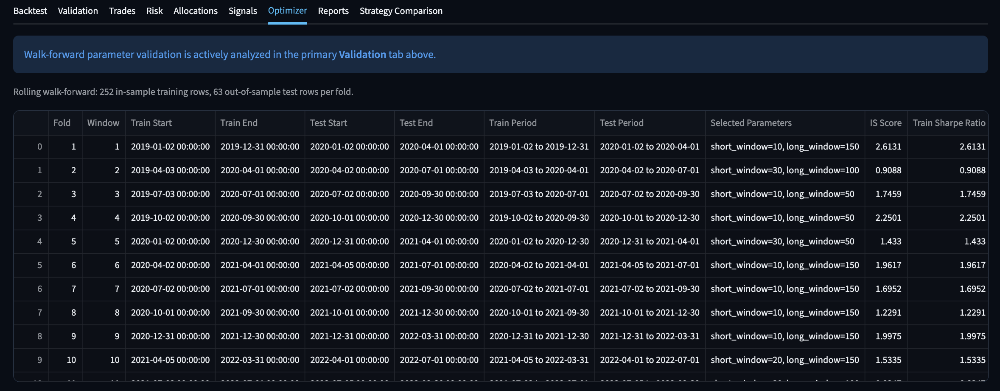

# Quant Strategy Lab

A Python-based algorithmic trading research and backtesting platform built with Streamlit. Explore six trading strategies, simulate portfolio performance, evaluate risk, and compare strategies using historical market data.

Quant Strategy Lab combines strategy development, portfolio simulation, performance analytics, parameter optimization, and walk-forward validation in one interactive dashboard.

---

## Dashboard Preview

### 1. Main Backtesting Dashboard

View portfolio performance, benchmark comparison, key performance indicators, and equity/drawdown charts.



### 2. Strategy Comparison

Compare all six strategies using common market data and performance metrics, including total return, annual return, volatility, Sharpe ratio, Sortino ratio, and maximum drawdown.



### 3. Walk-Forward Validation

Evaluate strategy performance using rolling training and out-of-sample testing windows, with parameters selected on training data and evaluated on subsequent unseen periods.



### 4. Trade Analysis

Inspect executed transactions, including execution dates, assets, quantities, prices, transaction costs, and trade values.



### 5. Risk Analytics

Analyse portfolio returns, volatility, drawdowns, Sharpe and Sortino ratios, Value at Risk (VaR), Conditional Value at Risk (CVaR), and monthly returns.



### 6. Portfolio Allocations

Visualise historical portfolio weights and understand how capital is allocated across different assets over time.



### 7. Trading Signals

Explore generated portfolio signals, asset weights, active trading days, turnover, and estimated transaction cost impact.



### 8. Optimizer Results

Review rolling walk-forward parameter selection, training scores, selected parameter combinations, and out-of-sample performance by fold.



---

## Trading Strategies

The platform implements six trading strategies:

| Strategy | Approach |
|---|---|
| Moving Average Crossover | Trend following using short- and long-term moving averages |
| RSI Mean Reversion | Identifies potential overbought and oversold conditions |
| MACD Trend Following | Uses MACD signals to identify market trends |
| Bollinger Mean Reversion | Uses Bollinger Bands to identify potential price reversals |
| Donchian Channel Breakout | Identifies breakouts above or below recent price channels |
| Buy and Hold | Invests in selected assets and maintains positions |

See [STRATEGY_GUIDE.md](STRATEGY_GUIDE.md) for further details.

## Key Features

- **Market Data:** Load historical adjusted-close prices from Yahoo Finance or CSV files.
- **Portfolio Backtesting:** Simulate portfolio performance using strategy-generated target weights.
- **Execution Costs:** Account for commissions and slippage.
- **Risk Management:** Configure position limits, gross exposure limits, and portfolio constraints.
- **Performance Analytics:** Calculate total return, CAGR, volatility, Sharpe ratio, Sortino ratio, and maximum drawdown.
- **Benchmark Comparison:** Evaluate strategy performance against a selected benchmark.
- **Walk-Forward Validation:** Evaluate strategies using rolling or expanding training and out-of-sample testing windows.
- **Parameter Optimization:** Explore strategy parameters and evaluate parameter selection across validation folds.
- **Trade Analysis:** Inspect executed trades, transaction costs, and portfolio turnover.
- **Portfolio Analytics:** Visualise asset allocations and generated trading signals.
- **Strategy Comparison:** Run all six strategies and compare their performance using common metrics.
- **Reporting:** Generate and inspect backtest performance reports.

## Technology Stack

- Python
- Streamlit
- Pandas
- NumPy
- Matplotlib
- Plotly
- yfinance
- SciPy
- pytest

## Project Structure

```text
quant-strategy-lab/
│
├── app.py
├── run_backtest.py
├── requirements.txt
├── README.md
├── STRATEGY_GUIDE.md
│
├── src/
│   ├── backtester/
│   │   ├── engine.py
│   │   ├── portfolio.py
│   │   ├── metrics.py
│   │   ├── optimizer.py
│   │   └── reporting.py
│   │
│   ├── data/
│   │   └── loader.py
│   │
│   └── strategies/
│       ├── base.py
│       ├── moving_average.py
│       ├── rsi.py
│       ├── macd.py
│       ├── bollinger.py
│       ├── donchian.py
│       └── buy_hold.py
│
├── tests/
├── docs/
│   ├── 01-backtest-dashboard.png
│   ├── 02-strategy-comparison.png
│   ├── 03-walk-forward-validation.png
│   ├── 04-trade-analysis.png
│   ├── 05-risk-analytics.png
│   ├── 06-portfolio-allocations.png
│   ├── 07-trading-signals.png
│   └── 08-optimizer-results.png
│
├── reports/
└── scripts/
```

## Installation and Setup

### 1. Clone the repository

```bash
git clone https://github.com/ankuchoudhary121/quant-strategy-lab.git
cd quant-strategy-lab
```

### 2. Create a virtual environment

```bash
python3 -m venv .venv
```

Activate on macOS/Linux:

```bash
source .venv/bin/activate
```

Activate on Windows:

```bash
.venv\Scripts\activate
```

### 3. Install dependencies

```bash
python -m pip install --upgrade pip
pip install -r requirements.txt
```

### 4. Launch the dashboard

```bash
python -m streamlit run app.py
```

Open the local address displayed in your terminal, usually:

```text
http://localhost:8501
```

The application supports Yahoo Finance data retrieval and CSV uploads. Yahoo Finance access requires an internet connection.

## Running a Backtest from the Command Line

The project also includes a command-line example:

```bash
python run_backtest.py
```

## Running Tests

Run the automated test suite:

```bash
pytest -q
```

The tests cover strategy behaviour, portfolio calculations, performance metrics, application functionality, and walk-forward validation.

## Backtesting Methodology

The application follows a modular backtesting workflow:

1. **Data loading:** Historical price data is retrieved from Yahoo Finance or uploaded through CSV.
2. **Signal generation:** The selected strategy analyses price data and generates target portfolio weights.
3. **Portfolio simulation:** The backtesting engine applies portfolio constraints, rebalancing rules, and transaction costs.
4. **Performance evaluation:** Portfolio equity and benchmark performance are calculated.
5. **Validation:** Walk-forward validation selects parameters on training windows and evaluates them on subsequent out-of-sample periods.

## Limitations

This project is intended for educational and quantitative research purposes. Historical backtesting results do not guarantee future performance.

- The simulator uses historical daily prices and simplified execution-cost assumptions.
- It does not fully model intraday execution, market impact, taxes, borrow availability, or order-book behaviour.
- Historical results depend on the selected assets, date range, strategy parameters, and market conditions.
- Walk-forward validation helps evaluate out-of-sample performance but cannot eliminate all forms of overfitting.
- The selected ticker universe is not automatically survivorship-bias-free.

## Author

**Ankita Choudhary**

Data Science and Business Analytics

GitHub: [@ankuchoudhary121](https://github.com/ankuchoudhary121)

**Project Repository:** [Quant Strategy Lab](https://github.com/ankuchoudhary121/quant-strategy-lab)

---

*Built as a Data Science and quantitative finance portfolio project.*
